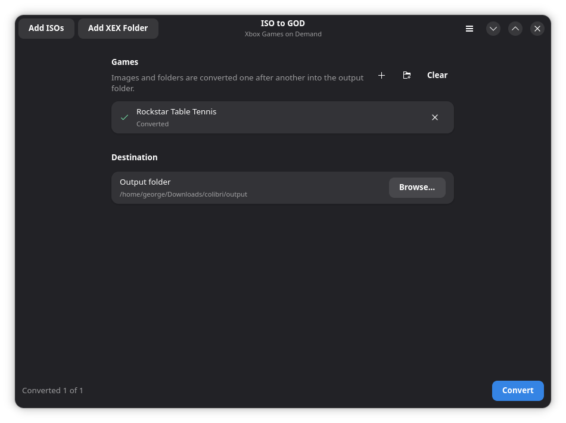

<h1 align="center">iso2god-next</h1>

<p align="center">
  Convert Xbox 360 and original Xbox ISO images into <strong>Games on Demand</strong> packages,<br>
  from a native desktop app or the command line, and send them straight to your console over FTP.
</p>

<p align="center">
  
</p>

## Features

- **Desktop app** built with GTK4 and libadwaita: add several ISOs at once (button, drag and drop, or command line), see per-image and overall progress, and cancel at any time.
- **FTP upload** to the console: after each conversion the finished package is copied to the Xbox 360 (Aurora, Freestyle Dash, XeXMenu and other FTP servers), with its own progress bar.
- **Command line tool** for scripting and batch jobs.
- **Fast**: part files are written in parallel across worker threads.
- **Trimming**: unused space at the end of the ISO can be dropped, which usually saves several gigabytes.
- **Title lookup**: the game name is filled in automatically from the built-in title database, or you can set your own.
- Handles both Xbox 360 and original Xbox images.

## Download

Grab the latest build from the [releases page](https://github.com/georgewoodall82/iso2god-next/releases).

| What | File |
| ---- | ---- |
| Desktop app for Linux | `iso2god-next-gui-x86_64.AppImage` or `iso2god-next-gui-aarch64.AppImage` |
| Command line tool | `iso2god-next-<arch>-linux`, `-macos` or `-windows.exe` |

To run the AppImage, make it executable and start it:

```sh
chmod +x iso2god-next-gui-x86_64.AppImage
./iso2god-next-gui-x86_64.AppImage
```

The AppImage is built on Ubuntu 24.04, so it needs a distribution with glibc 2.39 or newer (Ubuntu 24.04, Fedora 40, Debian 13 and later). The desktop app is Linux-only for now; on other systems use the command line tool.

## Desktop app

1. **Add ISOs** with the button, by dragging files into the window, or on the command line.
2. **Choose an output folder.**
3. **Convert.** Images are converted one after another, and a toast tells you when everything is done.
4. **Upload (optional).** Open **Settings → FTP upload**, enter the console's IP address and use **Test connection** to check it. The username and password default to `xboxftp`. Converted games are copied to `Hdd1:\Content\0000000000000000` unless you change the content folder.

| Shortcut | Action |
| -------- | ------ |
| <kbd>Ctrl</kbd>+<kbd>O</kbd> | Add ISOs |
| <kbd>Ctrl</kbd>+<kbd>Return</kbd> | Convert |
| <kbd>Esc</kbd> | Cancel the running conversion |
| <kbd>Ctrl</kbd>+<kbd>,</kbd> | Settings |
| <kbd>F1</kbd> | About |

FTP settings are saved to `~/.config/iso2god-next/ftp.json` (or under `$XDG_CONFIG_HOME`). The password is stored in plain text, and the file is created readable only by you.

### Building the app

You need Rust 1.85 or newer plus the GTK 4.10+ and libadwaita 1.5+ development files.

```sh
# Fedora
sudo dnf install gtk4-devel libadwaita-devel

# Debian / Ubuntu
sudo apt install libgtk-4-dev libadwaita-1-dev
```

```sh
git clone https://github.com/georgewoodall82/iso2god-next
cd iso2god-next
cargo run --release -p iso2god-next-gui
```

Optional arguments:

```sh
iso2god-next-gui [-o|--output DIR] [ISO_FILE ...]
```

[`gui/data/`](gui/data) contains a desktop entry and an icon if you want to install the app system-wide.

## Command line

The CLI has no GUI dependencies. Prebuilt binaries are on the releases page (see [Download](#download)), or build it yourself:

```sh
cargo build --release
./target/release/iso2god-next game.iso ./output
```

```
Usage: iso2god-next [OPTIONS] <SOURCE_ISO> <DEST_DIR>

Arguments:
  <SOURCE_ISO>  ISO file to convert
  <DEST_DIR>    A folder to write resulting GOD files to

Options:
      --dry-run             Do not convert anything, just print the title info
      --game-title <TITLE>  Set game title
      --trim[=<TRIM>]       Whether to trim off unused space from the ISO image;
                            passing no --trim flag at all is equivalent to "from-end" [possible values: from-end, none]
  -j, --num-threads <N>     Number of worker threads to use [default: 1]
  -h, --help                Print help (see more with '--help')
  -V, --version             Print version
```

`--dry-run` prints the title ID, name, type and the size before and after trimming without writing anything.

## Using the library

The conversion pipeline has no UI code in it, so you can call it from your own program:

```rust
use iso2god_next::{convert, ConvertOptions};

let options = ConvertOptions::new("game.iso", "output");
convert(&options, |progress| {
    println!("{}: {:.0}%", progress.stage.label(), progress.fraction() * 100.0);
})?;
```

`inspect()` reads an image's metadata without converting it, and `convert_cancellable()` takes a `CancelToken` so long conversions can be stopped.

## Project layout

| Path | Purpose |
| ---- | ------- |
| `src/convert.rs` | The conversion pipeline: `inspect()`, `convert()`, progress and cancellation |
| `src/iso/`, `src/god/`, `src/executable/`, `src/game_list/` | ISO parsing, Games on Demand writing and the title database |
| `src/bin/iso2god-next.rs` | Command line frontend |
| `gui/src/app.rs` | Main window |
| `gui/src/row.rs` | One row per ISO, with its own progress bar |
| `gui/src/task.rs` | Background threads for inspection, conversion and upload |
| `gui/src/ftp.rs` | Minimal FTP client that copies a package to the console |
| `gui/src/settings.rs`, `gui/src/settings_dialog.rs` | Saved FTP settings and the dialog that edits them |
| `tests/convert.rs` | End-to-end tests using a generated synthetic ISO |

## Tests

```sh
cargo test --all
```

The integration tests build a tiny synthetic Xbox image, convert it, and check the resulting data file and CON header, so the whole pipeline is covered without a retail disc image. The FTP code is tested against an in-process mock server.

## Credits and licence

iso2god-next is a fork of [iso2god-rs](https://github.com/iliazeus/iso2god-rs) by Ilia Pozdnyakov, which is itself a rewrite of [iso2god-cli](https://github.com/eliecharra/iso2god-cli) by Elie Charra. The core conversion code comes from there; the desktop app, FTP upload and the reorganised library are new in this fork.

Released under the [MIT licence](LICENSE).
